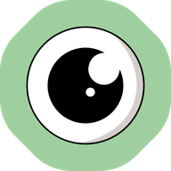

<h1 align="center">Búho</h1>

Registro del bebé: sueño, tomas y pañales · Baby log: sleep, feeds and diapers 
<b>Funciona sin conexión · Works offline</b>

<b>Español</b> ·
<a href="README.en.md">English</a> ·
<a href="README.zh-CN.md">简体中文</a> ·
<a href="README.hi.md">हिन्दी</a> ·
<a href="README.pt.md">Português</a> ·
<a href="README.ja.md">日本語</a> ·
<a href="README.de.md">Deutsch</a> ·
<a href="README.id.md">Bahasa Indonesia</a> ·
<a href="README.ru.md">Русский</a> ·
<a href="README.fr.md">Français</a> ·
<a href="README.it.md">Italiano</a>

<b>▶ App: <a href="https://outsidestructure787.github.io/buho/">outsidestructure787.github.io/buho</a></b> · versión 0.5.1

---

## Qué es Búho
Búho es una app para apuntar lo que hace el bebé con un solo toque: cuándo se duerme y cuándo se despierta, las tomas (pecho, biberón o sacaleches), los pañales y cosas como el peso, la temperatura o las medicinas. Está pensada para usarla medio dormido a las 3 de la mañana, con botones grandes, modo oscuro y una sola mano.

Funciona sin cobertura: lo que apuntas se guarda en el móvil al momento. Si queréis usarla dos personas, cada una desde su móvil, se puede conectar a una hoja de Google para que los dos móviles se pongan al día solos cuando haya señal. Sirve para Android, iPhone y ordenador, no hay que pasar por ninguna tienda de aplicaciones y es gratis.

Los datos son tuyos. Búho no tiene servidores propios: lo que apuntas está en tu móvil y, si activas la sincronización, en una hoja de cálculo de tu cuenta de Google.

## Qué necesitas
- **Para usarla en un solo móvil:** solo el móvil. Son dos minutos (paso 1).
- **Para usarla en dos o más móviles:** una cuenta de Google (la de Gmail sirve) y un ordenador durante unos 15 minutos, una sola vez (paso 2). Desde el móvil también se puede, pero el editor de Google es incómodo en pantalla pequeña.
- **Para ver las visitas del pediatra y recibir avisos de medicación:** lo mismo que en el paso 2 y un calendario de Google. Son 5 minutos más (paso 3).

No hace falta saber programar. Hay que copiar y pegar un texto y pulsar unos cuantos botones, y aquí se explica cada uno.

## Paso 1. Instalar la app en el móvil
1. Abre esta dirección en el móvil: **https://outsidestructure787.github.io/buho/**
   - En Android, usa Chrome.
   - En iPhone, usa Safari.
2. Añádela a la pantalla de inicio:
   - **Android (Chrome):** toca los tres puntos de arriba a la derecha (⋮) y elige *Instalar aplicación* o *Añadir a pantalla de inicio*. Confirma.
   - **iPhone (Safari):** toca el botón de compartir (el cuadrado con una flecha hacia arriba, abajo en el centro), baja un poco y elige *Añadir a pantalla de inicio*. Pulsa *Añadir*.
3. Cierra el navegador y abre Búho desde su icono, el ojo verde. A partir de ahora ábrela siempre desde ahí: así funciona como una app normal, a pantalla completa y sin cobertura.
4. Toca el engranaje de arriba a la derecha (Ajustes) y rellena *Datos del bebé*: nombre, fecha de nacimiento y sexo. En *Configuración*, escribe quién usa ese móvil (por ejemplo, «Mamá» o «Papá»). Pulsa *Guardar*.

Ya puedes usarla. Si solo la va a usar una persona, no necesitas nada más.

## Paso 2 (opcional). Compartir el registro entre varios móviles
Búho guarda los datos en una hoja de cálculo de Google que creas tú. Los móviles mandan ahí lo que apuntan y se traen lo que han apuntado los demás. Para que la hoja y la app se entiendan hay que pegar en la hoja un pequeño programa (un «script») que está en este repositorio. Se hace una vez.

### 2.1. Crea la hoja
En el ordenador, entra en [sheets.new](https://sheets.new) con tu cuenta de Google. Se abre una hoja en blanco. Arriba a la izquierda pone *Hoja de cálculo sin título*: haz clic y llámala, por ejemplo, *Búho*.

No hace falta escribir nada en ella. La pestaña donde se guardan los registros se crea sola la primera vez que sincronices.

### 2.2. Pega el script
1. Abre [el script en formato texto](https://raw.githubusercontent.com/outsidestructure787/buho/main/apps-script/Code.gs) en otra pestaña. Verás una página llena de código. Selecciónalo todo con `Ctrl + A` (en Mac, `Cmd + A`) y cópialo con `Ctrl + C` (`Cmd + C`).
2. Vuelve a la hoja. En el menú de arriba, pulsa *Extensiones* y luego *Apps Script*. Se abre una pestaña nueva con el editor de scripts de Google.
3. El editor trae un archivo llamado `Código.gs` con unas líneas de ejemplo (`function myFunction() { }`). Haz clic dentro, selecciónalo todo (`Ctrl + A`) y bórralo, hasta que quede vacío.
4. Pega el código que copiaste (`Ctrl + V`). La primera línea empieza por `/**` y la última es una llave: `}`.
5. Arriba a la izquierda pone *Proyecto sin título*. Si quieres, cámbialo por *Búho*.
6. Guarda con el icono del disquete o con `Ctrl + S`.

Si en el menú *Extensiones* no aparece *Apps Script*, seguramente estás con una cuenta de trabajo o de un colegio que lo tiene bloqueado. Usa una cuenta personal de Gmail.

### 2.3. Crea tu clave
La clave es una contraseña que solo conocerán vuestros móviles. Sin ella, nadie más puede leer ni escribir en la hoja. Va en un archivo aparte para que no se pierda cuando actualices el script.

1. En la columna izquierda del editor, junto a *Archivos*, pulsa el **+** y elige *Secuencia de comandos*. Escribe `Config` y pulsa Intro.
2. Borra lo que traiga el archivo nuevo y pega el contenido de [`Config.gs`](https://raw.githubusercontent.com/outsidestructure787/buho/main/apps-script/Config.gs), que son pocas líneas.
3. Busca la línea `const CLAVE = 'CAMBIA-ESTA-CLAVE';` y cambia solo el texto `CAMBIA-ESTA-CLAVE` por una clave inventada y larga. Lo más fácil es juntar cuatro palabras al azar: `jirafa-lunes-tostada-nube`. No borres las comillas ni el punto y coma.
4. Guarda (`Ctrl + S`). En la columna izquierda tienen que verse dos archivos: `Código.gs` y `Config.gs`.

Apunta la clave en algún sitio: la necesitarás en el móvil.

### 2.4. Publica el script
Publicarlo le da una dirección de internet a la que el móvil puede enviar los datos.

1. Arriba a la derecha, pulsa el botón azul *Implementar* y elige *Nueva implementación*.
2. Al lado de *Seleccionar tipo* hay una rueda dentada. Púlsala y elige *Aplicación web*.
3. Rellena así:
   - *Descripción:* lo que quieras, por ejemplo «Búho».
   - *Ejecutar como:* **Yo** (aparece tu correo).
   - *Quién tiene acceso:* **Cualquier usuario**. Es necesario para que los móviles puedan conectar sin iniciar sesión en Google. La clave del paso anterior es lo que impide que entre otra persona.
4. Pulsa *Implementar*. Google te pedirá permisos:
   1. Pulsa *Autorizar acceso* y elige tu cuenta.
   2. Saldrá una pantalla que dice que Google no ha verificado la aplicación. Es normal: el script lo has pegado tú y no ha pasado por la revisión de Google. Pulsa *Configuración avanzada* y después *Ir a Búho (no seguro)*.
   3. Revisa los permisos (ver y editar tus hojas de cálculo y tus calendarios) y pulsa *Permitir*. El script funciona con tu cuenta y solo hace lo que pide Búho: guardar registros en esta hoja y, si lo activas, leer y crear eventos en el calendario.
5. Aparece la *URL de la aplicación web*, una dirección larga que empieza por `https://script.google.com/macros/s/` y termina en `/exec`. Pulsa *Copiar* y guárdala. Después pulsa *Hecho*.

Para llevar la dirección y la clave al móvil, lo más cómodo es enviártelas por correo o por un chat contigo mismo.

### 2.5. Conecta el primer móvil
1. En Búho, toca el engranaje y abre *Configuración*.
2. En *Sincronización con Google Sheets*, pega la dirección en el primer campo y escribe la clave en *Clave de acceso*.
3. Pulsa *Guardar y probar conexión*. Si todo va bien, sale «Conexión correcta» y arriba, junto al título, pone «Sincronizado».

Vuelve a la hoja de Google en el ordenador: habrá una pestaña nueva con lo que tuvieras apuntado.

### 2.6. Conecta los demás móviles
En el móvil que ya funciona, ve a *Ajustes → Configuración* y pulsa *Compartir configuración con otro móvil*. Envía el enlace a la otra persona por WhatsApp, Telegram o correo. El enlace lleva la dirección y la clave, así que compártelo solo con quien vaya a apuntar.

- **Si el otro móvil es Android:** que instale Búho (paso 1) y luego abra el enlace. La app se conecta sola.
- **Si el otro móvil es iPhone:** que instale Búho (paso 1), copie el enlace y lo pegue en *Ajustes → Configuración*, en el campo *…o pega aquí un enlace de configuración*. Después, *Guardar y probar conexión*. En iPhone hay que hacerlo así porque la app instalada no comparte datos con Safari.

Que cada persona escriba su nombre en *¿Quién usa este móvil?*. Así, en el registro se ve quién apuntó cada cosa.

### Cómo se ve la hoja
Cada registro es una fila de la pestaña `eventos`: fecha, hora de inicio y fin, duración (en sueños y tomas de pecho), tipo, detalle, nota y quién lo apuntó. Puedes filtrarla, ordenarla o hacer gráficas como con cualquier hoja. Las columnas grises del final las usa la app: no las cambies a mano. Si borras algo desde la app, la fila no desaparece; queda marcada como borrada en la columna *borrado*.

## Paso 3 (opcional). Visitas del calendario y avisos de medicación
Con la sincronización funcionando, Búho puede enseñarte las próximas visitas (pediatra, matrona, vacunas) de un calendario de Google, apuntar visitas nuevas y crear avisos con alarma para la siguiente toma de un medicamento.

1. **Elige el calendario.** Puede ser tu calendario principal o uno compartido solo para el bebé, que es lo más práctico si sois dos. Para crear uno: en [Google Calendar](https://calendar.google.com), en la columna izquierda, junto a *Otros calendarios*, pulsa **+** → *Crear calendario*. Compártelo con la otra persona si queréis verlo los dos.
2. **Copia su ID** (no hace falta si usas el principal). En Google Calendar, pasa el ratón por encima del calendario, pulsa los tres puntos → *Configuración y uso compartido* y baja hasta *Integrar el calendario*. El *ID de calendario* es un texto largo que termina en `@group.calendar.google.com`.
3. **Actívalo en Búho:** *Ajustes → Calendario*.
   - Marca *Mostrar las próximas visitas de Google Calendar*.
   - En *Calendario*, deja `primary` si es tu calendario principal, o pega el ID.
   - *Mostrar solo eventos que contengan* sirve para no ver todo tu calendario personal. Por ejemplo: `pediatra, matrona, vacuna, revisión`. Si lo dejas vacío, se ven todos los eventos.
   - Pulsa *Guardar*. En la pantalla principal aparece la tarjeta *Próximas visitas*. Al tocarla puedes ver la lista completa o añadir una visita.
4. **Avisos de medicación:** en *Ajustes → Medicación*, añade el medicamento (nombre, dosis, cada cuántas horas y, si quieres, durante cuántos días), activa *Mostrar la medicación en la pantalla principal* y marca *Crear un aviso en Google Calendar para la próxima toma*. Cada vez que pulses *Dada*, se crea en el calendario un evento «💊 nombre del medicamento» a la hora de la siguiente toma, con alarma. Para que suene, el calendario tiene que tener las notificaciones activadas en la app de Google Calendar del móvil.

El calendario lo lee el script con la cuenta de Google donde está la hoja. Si usas un calendario de otra persona, tiene que estar compartido con esa cuenta. Si montaste la sincronización antes de la versión 0.3.0, primero actualiza el script (ver más abajo) y después, en el editor, elige la función `autorizar` en el desplegable de arriba, pulsa *Ejecutar* y acepta los permisos del calendario. Por último, publica la versión nueva.

## Si algo no funciona
- **Pone «La clave no coincide con la de la hoja».** La clave escrita en el móvil no es exactamente la de `Config.gs`. Se distinguen mayúsculas y minúsculas, y un espacio de más también cuenta.
- **Pone «No se pudo conectar».** No hay cobertura, o la dirección está mal copiada. Tiene que terminar en `/exec`.
- **Pone «Actualiza el script de Google para usar el calendario».** La app pide el calendario, pero el script publicado es una versión antigua. Sigue los pasos de *Actualizar el script de Google*.
- **Pone «Falta autorizar el calendario».** En el editor del script, elige `autorizar` en el desplegable de funciones, pulsa *Ejecutar* y acepta. Después publica una versión nueva.
- **Pone «No encuentro el calendario».** El ID está mal copiado, o el calendario no está compartido con la cuenta donde está la hoja.
- **La app no se actualiza.** Ábrela con conexión y espera unos segundos: se recarga sola. Si no, ciérrala del todo (quítala de las apps recientes) y vuelve a abrirla. También puedes ir a *Ajustes* y tocar *Buscar actualizaciones*, abajo del todo, junto al número de versión.
- **En el iPhone, el enlace de configuración se abre en Safari y no en la app.** Es normal. Copia el enlace y pégalo en *Ajustes → Configuración* dentro de la app instalada.

## Actualizar el script de Google
La app se actualiza sola, pero el script de la hoja no. Solo hace falta cuando una versión nueva lo diga en la [lista de cambios](../../commits/main) o cuando la app te avise.

1. En la hoja: *Extensiones → Apps Script*.
2. Abre `Código.gs`, borra todo su contenido y pega el nuevo [`Code.gs`](https://raw.githubusercontent.com/outsidestructure787/buho/main/apps-script/Code.gs). Guarda. No toques `Config.gs`: ahí está tu clave.
3. *Implementar → Gestionar implementaciones*. Pulsa el lápiz, en *Versión* elige *Versión nueva* y pulsa *Implementar*.

La dirección `/exec` sigue siendo la misma, así que en los móviles no hay que cambiar nada. Si la versión nueva añade columnas a la hoja, aparecen solas en la siguiente sincronización.

Si montaste la sincronización con la versión 0.1.x (un solo archivo con la clave dentro), antes de pegar el código nuevo apunta lo que pone en `CLAVE` y en `HOJA`. Después crea `Config.gs` como en el paso 2.3 con esos mismos valores.

## Preguntas frecuentes
**¿Qué pasa si no hay cobertura?** Apuntas igual. Arriba se ve cuántos registros faltan por enviar, y se envían solos cuando vuelve la señal.

**¿Y si dos personas apuntan a la vez sin conexión?** Al volver la señal se juntan los registros de las dos. Si las dos editan el mismo registro, se queda la última edición.

**¿Es seguro?** La hoja es privada y está en tu cuenta de Google. El script solo responde si recibe la clave correcta. Quien tenga el enlace de configuración (o la dirección y la clave) puede leer y escribir en el registro, y ver los eventos del calendario que deje pasar el filtro, así que compártelo solo con quien deba apuntar.

**¿Dónde se guardan los datos?** En el móvil y, si activas la sincronización, en tu hoja de Google. Si usas Búho sin sincronizar y borras los datos del navegador o cambias de móvil, se pierden. En ese caso, exporta el CSV de vez en cuando desde *Ajustes → Exportar CSV*.

**¿Cuesta algo?** No. GitHub Pages, Google Sheets, Apps Script y Google Calendar son gratuitos para este uso.

## Qué incluye
- Botones grandes para dormir/despertar, lactancia (pecho izquierdo o derecho, con cronómetro opcional), biberón (materna o fórmula), pañal (pis, caca o ambas) y anotaciones (nota, peso, temperatura, medicación y más, o algo que pasó antes).
- De un vistazo: cronómetros en marcha, cuánto hace de la última toma, del último sueño y del último pañal, y qué pecho toca.
- Resumen del día, gráfica de los últimos 7 días, gráficas de peso, talla y perímetro de la cabeza, y el registro con las últimas 14 entradas. Con *Mostrar más* se abre el registro completo con filtros.
- Medicación con cuenta atrás hasta la próxima toma, duración del tratamiento y avisos en Google Calendar.
- Próximas visitas de Google Calendar y la opción de añadir visitas desde la app.
- Exportación a CSV (7 días, 30 días o todo), que se puede enviar desde el menú de compartir del móvil.
- Tres estilos: Búho (por defecto), Noir (negros y grises) y [Catppuccin](https://catppuccin.com), en modo claro, oscuro o automático.
- Pantalla encendida mientras hay una toma con cronómetro, y la opción de ocultar secciones.
- En español, inglés, catalán, francés, portugués, italiano y alemán.

## Usar tu propia copia
Si prefieres tener tu propia versión de la app, haz un *fork* de este repositorio y activa *Settings → Pages → Deploy from a branch → main / (root)*. Son archivos estáticos, sin compilación ni dependencias: `index.html`, `i18n.js`, `sw.js`, `manifest.webmanifest` e `icons/`. Para añadir un idioma, copia un bloque de `i18n.js`.

## Sobre el proyecto
Voy a ser padre en breve y buscaba una app para apuntar las tomas, los sueños y los pañales que se ajustara a lo que necesitamos en casa: que funcione sin cobertura, que la podamos usar los dos desde móviles distintos y que los datos sean nuestros. Probé varias y ninguna me servía, así que decidí hacerme una a medida.

No soy programador. Búho lo he hecho con ayuda de una IA ([Claude](https://claude.ai)), así que pido disculpas de antemano a los desarrolladores profesionales por meterme en su terreno. Si veis algo mal hecho o que se puede mejorar, abrid un [issue](../../issues). Os lo agradeceré, y seguro que aprendo algo.

---

Licencia MIT · ver <a href="LICENSE">LICENSE</a>

